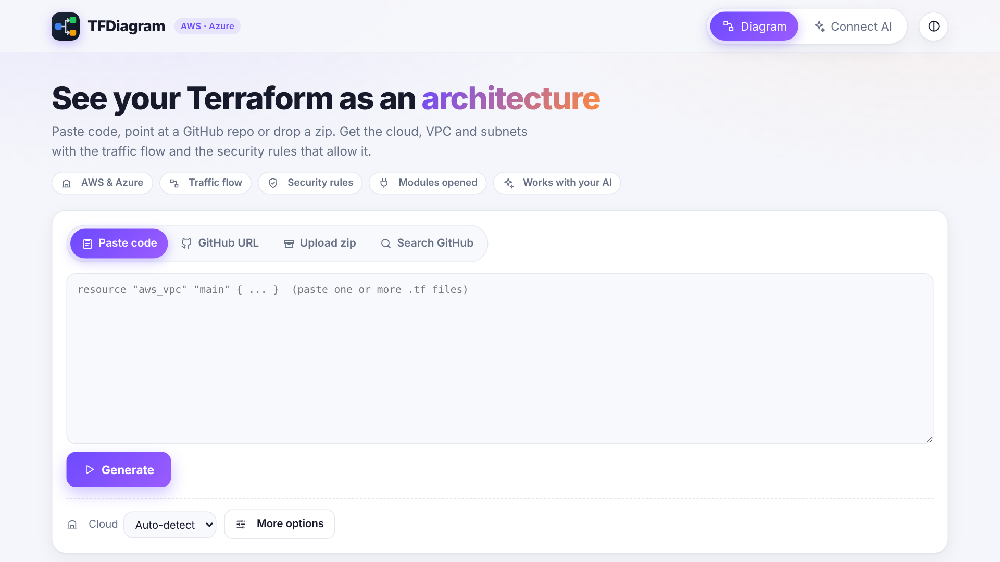
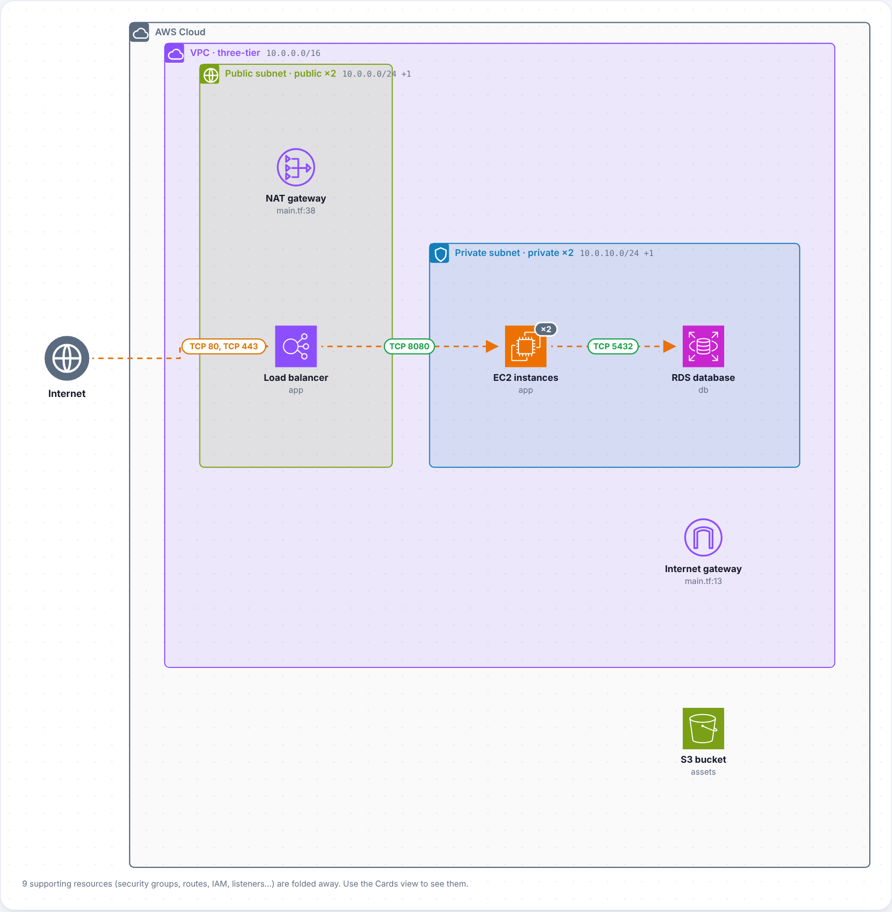
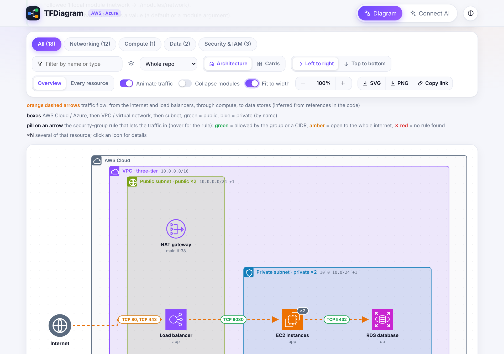
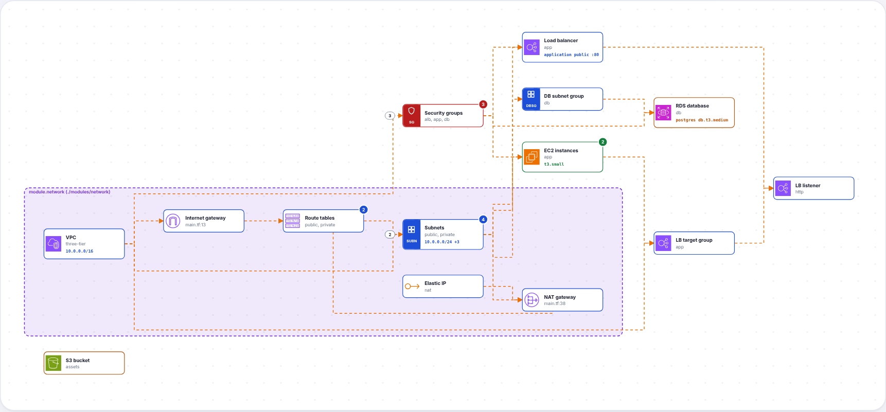
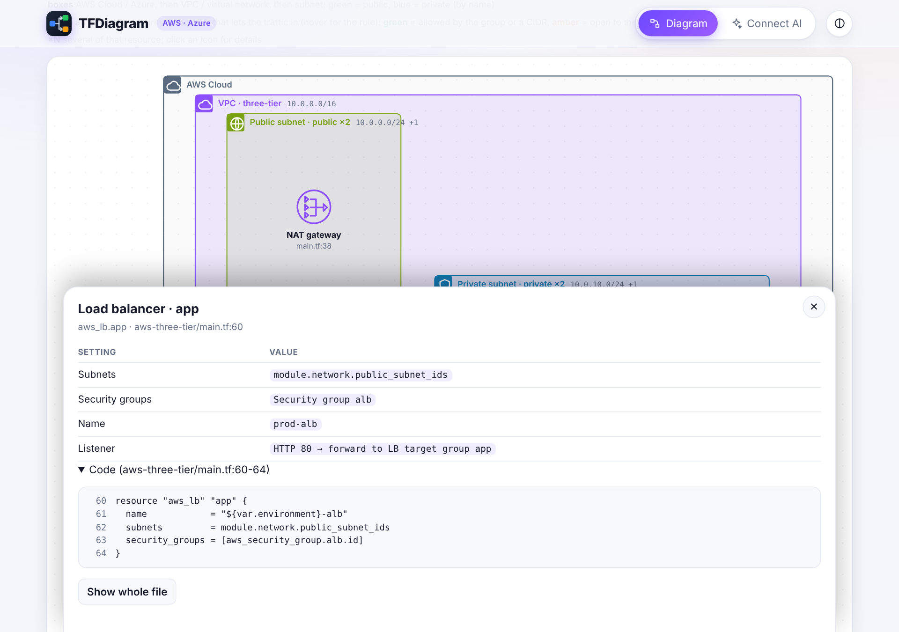
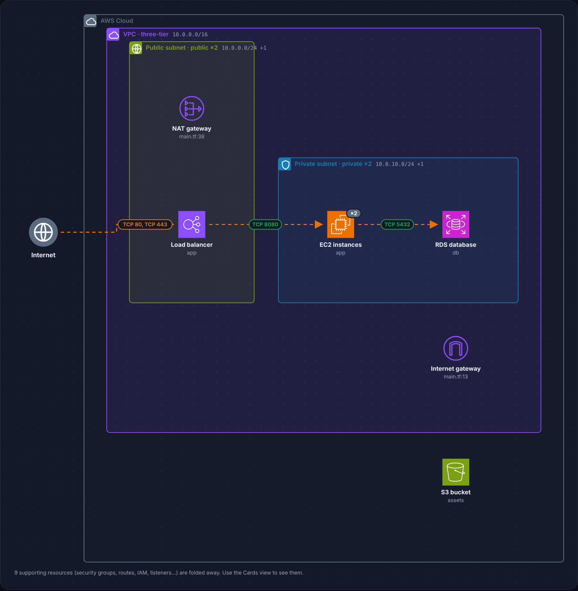
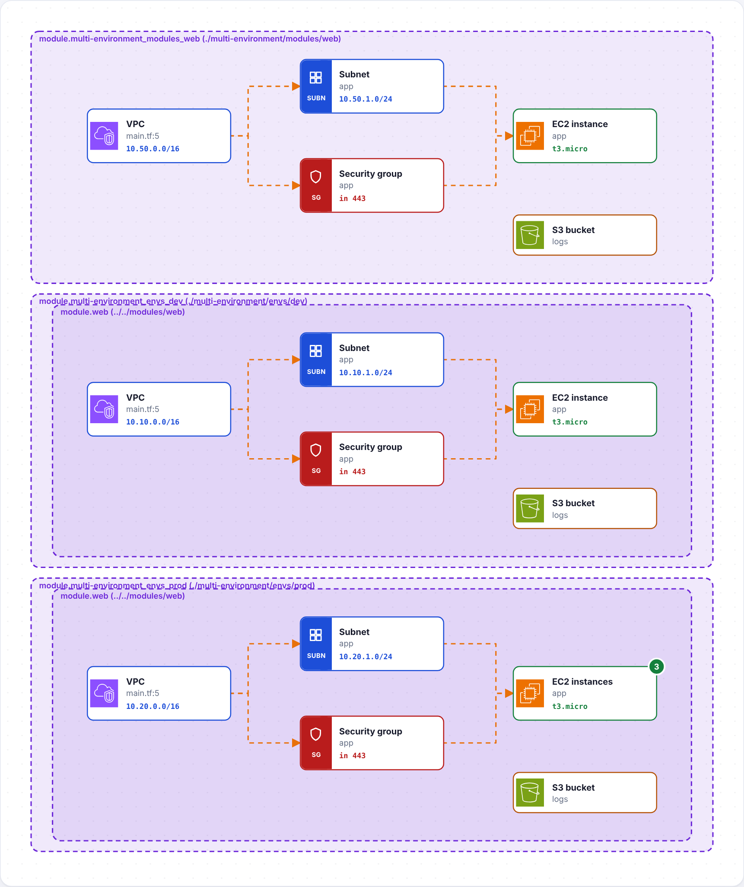
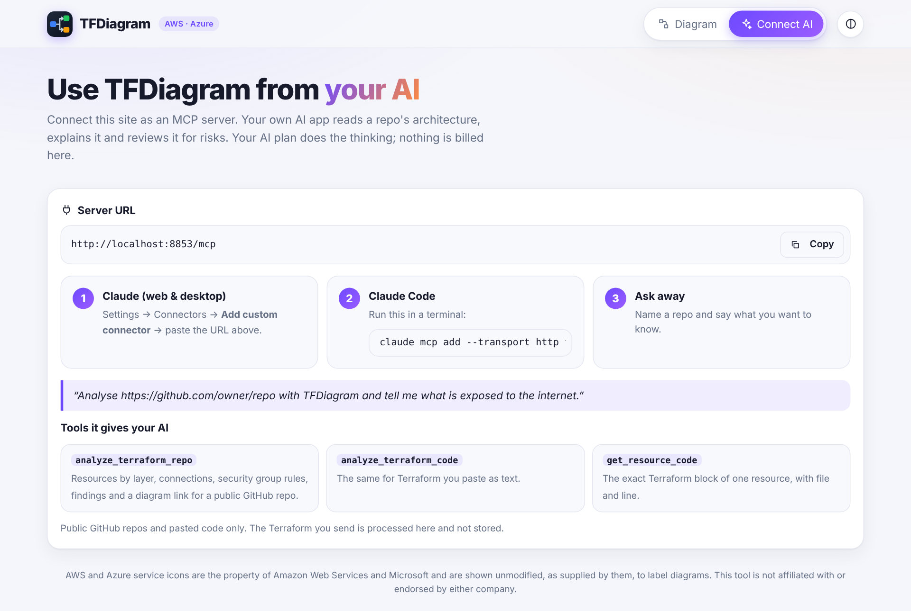
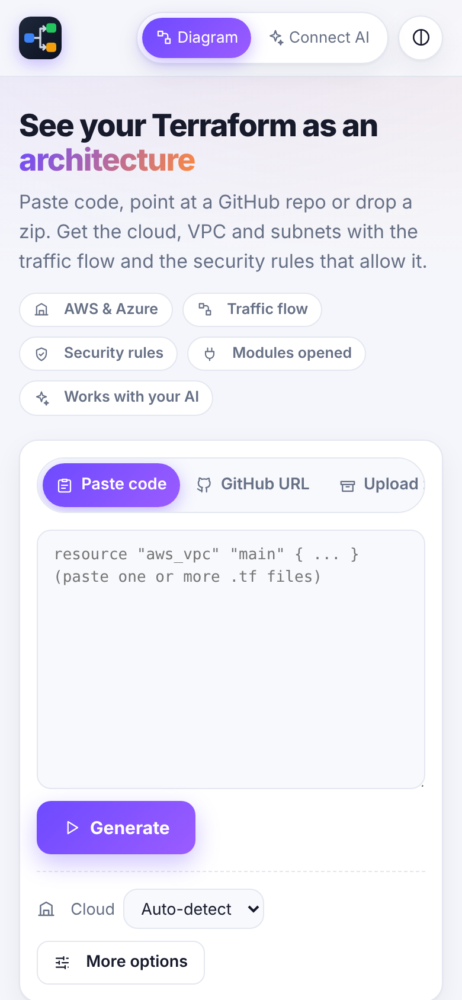

# TFDiagram

Turn Terraform (AWS or Azure) into an architecture diagram: cloud, VPC and subnets, big service icons, animated traffic
flow, and the security-group rules that allow each arrow. It parses the `.tf` files directly instead of guessing with an LLM.

## Screenshots

Made from the sample projects in `public/samples/` (AWS three-tier, multiple environments).

**Home**

**Architecture style**: cloud, VPC and subnet boxes, official icons, animated traffic flow, and a pill on each arrow naming the security-group rule that lets the traffic in (green allowed, amber open to the internet, red none found).

**Controls**: layers, filter, style, direction, zoom, SVG/PNG export and a link that reopens the same view.

**Cards style**

**Click a resource** for its settings, rules and the exact Terraform block (or the whole file).

**Dark theme**

**All folders**: every folder of a repo or zip drawn at once, each as a module box.

**Connect your own AI (MCP)**

**On a phone**

## Run it locally (private: your code stays on your machine)

Needs Node.js 20+ and git. There are no runtime dependencies.

    git clone https://github.com/Peermoh/tfdiagram.git
    cd tfdiagram
    npm start                      # http://localhost:3000
    npm test

Optional: `PORT=8080 npm start`; `GITHUB_TOKEN=... npm start` for private repos or a higher GitHub rate limit
(or paste a token on the page: sent per request, never stored).

## Ways to give it Terraform
- **Paste code**: one or more `.tf` files, or Terraform written as JSON (`.tf.json`); a pasted JSON object of values (`.tfvars.json`) is drawn as a sketch.
- **GitHub URL**: `https://github.com/owner/repo` or `.../tree/<branch>/<path>`. Public repos are downloaded as one zip
  (no API rate limit, nothing cut off); private ones need a token. If the repo has no `.tf` at the top level, its best
  folder is drawn and **Folder to draw** lists the others, plus **All folders** (each folder becomes a module box, up to 40).
- **Upload zip**: choose or drop a `.zip` (or GitHub's Code > Download ZIP). It is opened in the browser
  (`public/unzip.js`); only the `.tf` text and `terraform.tfvars` / `*.auto.tfvars` are sent for analysis. Samples to try
  are in `public/samples/` and linked on the page.
- **Private Git (this computer)**: shown only when the page is served by your own `npm start` (the public site never has it, and
  the Worker has no such endpoint). Paste an Azure DevOps link (`https://dev.azure.com/org/project/_git/repo`, with optional
  `?path=/dev&version=GBbranch`) or any https / ssh Git URL. The local server reads it with the **git installed on this computer**, so
  whatever you are already signed in with (Git Credential Manager, SSH keys, company single sign-on) is used, and a sign-in
  window may open once. For Azure DevOps you can instead give a personal access token (Code: Read), used for that request only.
  It then draws like an uploaded zip (folder picker, tfvars, `stack.json`). The server listens on `127.0.0.1` only and these
  endpoints refuse non-local requests; `TFDIAGRAM_LOCAL=0` turns them off, `HOST=...` changes where it listens (at your own risk).
  See `lib/localgit.js`, `lib/ado.js`. It cannot reuse a browser tab's login: a page on localhost cannot read your Azure DevOps cookies.
- **Search GitHub**: finds public Terraform repos (`/api/search`; sort, AWS/Azure filter, `org:` qualifiers work).
  Empty search shows the most popular ones. About 10 searches a minute without a token.

## What it shows
- **Architecture style** (default): AWS Cloud / Azure, then VPC, then subnet boxes (green = public, blue = private by name),
  large official icons, `x N` for several copies, animated traffic arrows from the internet and load balancers through
  compute to data stores. A pill on each arrow names the security-group rule that lets the traffic in (green allowed,
  amber open to the whole internet, red none found; hover for the rule). Rules that name another group add real arrows.
- **Cards style**: every resource as a card, grouped by layer, with module containers and details.
- Layers, filter, module scope, collapse modules, overview or every resource, left-to-right or top-to-bottom, zoom
  (buttons or Ctrl/Cmd + wheel), fit to width, light/dark theme.
- Click a resource: its settings, rules, routes, IP ranges and its Terraform block (or the whole file with the block
  highlighted). A **Terraform code** section shows every file.
- **Export** the diagram as SVG or PNG, or **Copy link** to reopen the same view (GitHub URL mode).
- A **Checks** list explains what was read, which folder was drawn, modules followed or missing, unknown variables,
  resources with `count = 0`, other providers, and so on (`lib/validate.js`).

## stack.json patterns
Some platform repos hold no Terraform resources, only a `stack.json` listing capabilities per tier (`{ "stack": { "cloud_routing": { "network": [ { "capability_name": "Cloud DNS", "include": ["GTS-1150-Amazon Route 53"] } ] }, "cloud_account": { "tier-2": {...}, "non-vpc": {...}, "tier-3": {...} }, "cloud_platform": {...} } }`). Upload such a zip (or paste the JSON) and it is drawn as tier boxes with each service's icon (AWS services are recognised by name, other tools like Splunk or Active Directory become plain tiles), plus a typical flow (Internet, DNS, load balancer, servers, storage / database) that is **inferred from the services**: the file does not say how they connect. Folders with a `stack.json` (dev, staging, prod) appear under Folder to draw. See `lib/stack.js` and `public/samples/stack-pattern.zip`.

## JSON
`*.tf.json` files (in zips and GitHub repos) and pasted Terraform JSON are converted to HCL first (`lib/json.js`); `"${var.x}"` becomes the expression `var.x`, arrays of objects become blocks. `terraform.tfvars.json` and `*.auto.tfvars.json` apply like their `.tfvars` twins, and every `*.tfvars.json` appears in the Variable file dropdown. Not covered: `.tf.json` in the rare case of a repo too big for the zip download (the file-by-file fallback reads `.tf` only).

## Values and modules
- `variable` defaults, `locals`, `count` / `for_each` (resources that work out to 0 are hidden; tick "also show" to see them),
  `cidrsubnet`, `for` expressions, ternaries and common functions are evaluated (`lib/details.js`, `lib/cidr.js`).
- `terraform.tfvars` and `*.auto.tfvars` next to the drawn folder apply to the root module. **More options > Variable
  values** takes `name = value` lines that override them. **More options > Variable file** lists every `.tfvars` in the repo or zip (for example `envs/prod.tfvars`): pick one to draw that environment (it is applied on top of the auto-loaded files, like `-var-file`). A `.tfvars` pasted on its own only holds values, so it can only be drawn as a clearly labelled **sketch**: guesses from variable names such as `vpc_cidr`, `public_subnets`, `instance_count`, `db_engine`, `bucket_name`, or Azure's `address_space`, `subnet_prefixes`, `vm_size` (`lib/sketch.js`). Names it doesn't recognise draw nothing.
- Local modules (`./x`, `../../`) are followed. Registry modules (`terraform-aws-modules/vpc/aws`, with `version`
  constraints) and GitHub sources (`github.com/o/r`, `git::https://...?ref=`, `//subdir`) are downloaded as zips and opened
  too (max 8 downloads per diagram; `examples/` and `tests/` skipped; `lib/registry.js`). Module outputs and inputs are traced
  to the resources behind them.

## Use it from your own AI (MCP)
The site is also an MCP server at `/mcp` (Streamable HTTP, stateless, no login). Your AI app does the thinking on your own
plan; this site only parses Terraform. Tools: `analyze_terraform_repo`, `analyze_terraform_code`, `get_resource_code`
(`lib/mcp.js`). Claude (web/desktop): Settings > Connectors > Add custom connector > paste `https://<your site>/mcp`.
Claude Code: `claude mcp add --transport http tfdiagram https://<your site>/mcp`. Public repos and pasted code only.

## How it is built
- `lib/parse.js` extracts blocks; `lib/graph.js` builds nodes and edges (references, module outputs, locals, attachments);
  `lib/details.js` and `lib/cidr.js` evaluate expressions; `lib/modules.js` loads module trees; `lib/github.js`,
  `lib/zipdl.js` and `lib/registry.js` fetch code; `lib/api.js` is the runtime-agnostic handler used by both
  `worker.js` (Cloudflare) and `server.js` (local); `lib/search.js`, `lib/validate.js`, `lib/mcp.js`.
- `public/render.js` filters and summarises the graph; `public/diagram.js` draws the SVG (Cards and Architecture styles) with
  dagre for layout (`public/vendor/dagre.min.js`, MIT, (c) Chris Pettitt); `public/index.html` is the page.
- Tests: `npm test` (node:test; headless-browser checks were done ad hoc, not in the repo).

## Not yet
GCP, Terraform plan/state input, diffing two versions, non-GitHub module hosts, a security review
beyond the rule-based findings.

## Official AWS and Azure icons
The icons in `public/icons/` were imported from the vendors' packs with `npm run icons` (see `scripts/import-icons.mjs`
and the "Import official icons" GitHub Action). They are shown unmodified with an attribution note. Read the vendors' icon
terms before redistributing; delete `public/icons/*` and reset `manifest.json` to `{}` to fall back to the built-in icons.

## Deploy (Cloudflare Workers)
`wrangler.jsonc` serves `public/` as static assets and routes `/api/*` and `/mcp` to `worker.js`. In the Cloudflare dashboard:
Workers & Pages > Create > Import a repository > this repo, name `tfdiagram`, empty build command, deploy command
`npx wrangler deploy`. Recommended: add a `GITHUB_TOKEN` secret (`npx wrangler secret put GITHUB_TOKEN`) to raise the shared
GitHub rate limit for search and fallbacks. API responses are sent with `Cache-Control: no-store`.
